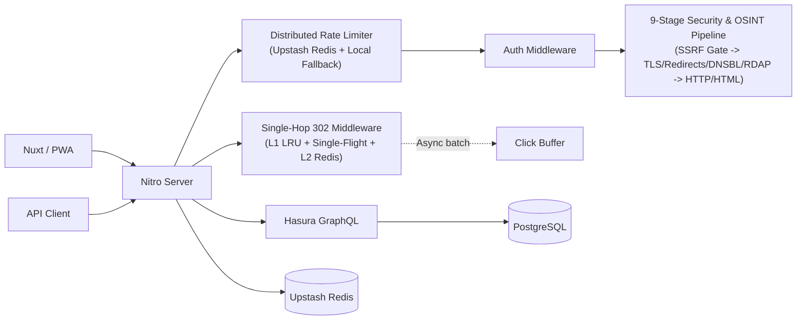

# Links — `links.mikeodnis.dev`

High-throughput, security-verified URL shortener and privacy-first click analytics platform built with **Nuxt 4**, **Nitro**, **Effect v4**, **Hasura GraphQL**, and **Upstash Redis**.

[](https://github.com/WomB0ComB0/link-shortener/actions/workflows/ci.yml)
[](https://github.com/WomB0ComB0/link-shortener/releases)
[](LICENSE)

## Features

- **Single-hop `302 Found` redirects (`GET /{code}`)**: Intercepted directly at Nitro server middleware (`server/middleware/02-shortlink-redirect.ts`) with a multi-tier **L1 LRU + single-flight + Upstash Redis** cache-aside layer and `410 Gone` handling for expired/disabled links.
- **9-stage synchronous URL security & OSINT pipeline** (inspired by `lissy93/web-check`): Runs on both link creation (`POST /api/links/create`) and edits (`PATCH /api/links/update`) covering syntax/SSRF, DNS private-IP & CNAME-cloaking guards, TLS/SSL certificates & cipher suites, multi-hop redirect chains, phishing/homograph heuristics, malware & Google Safe Browsing, zero-key threat-intel DNSBLs (**Cloudflare Security `1.1.1.2`**, **Quad9 `9.9.9.9`**, optional **Abuse.ch URLhaus**), **IANA RDAP** domain age/`serverHold` suspension + DNSSEC/CAA/SPF/DMARC, and **HTTP security headers (`A+`–`F`)**, drive-by executable `Content-Type`/`Content-Disposition` blocking, and bounded 16 KiB HTML `<meta http-equiv="refresh">` cloaking detection.
- **Distributed API rate limiter**: Upstash Redis-backed per-route policies (**Token Bucket** for `redirect`/`api`, **Sliding Window** for `auth`/`create`/`verify`/`ai`/`slow`), identity-aware keying (`user:<id>`, hashed `apikey:<sha256-16>`, or trusted proxy IP), bounded in-process weighted sliding-window fallback when Redis is degraded, standard **IETF `RateLimit-*` + `RateLimit-Policy`** + `Retry-After` headers, and dedicated limiter telemetry on `/api/health`.
- **Unbiased short codes & atomic writes**: Cryptographically unbiased 7-character Base62 rejection sampling (legacy 6-char codes supported), atomic `INSERT` collision retries, custom aliases with reserved-route protection, and owner-authorized edits/deletions with immediate L1 + Redis cache invalidation.
- **Privacy-first batched click analytics**: Non-blocking bounded in-memory buffer flushed in batches without storing raw IP addresses (`ip_address: null`), stripping referrer query strings and fragments.
- **Authentication & scoped API keys**: Salted `scrypt` password hashing, signed HttpOnly session cookies / Bearer tokens, and SHA-256 hashed `sk_` developer API keys.
- **Live Console UI, Dynamic OG & PWA**: Nuxt UI v4 + Tailwind CSS v4, dynamic Satori + `@resvg/resvg-js` `1200x630` OpenGraph cards (`/api/og`, `/opengraph-image`, `/twitter-image`), installable PWA with Web Share Target, and SEO/AEO/GEO endpoints (`/llms.txt`, `/llms-full.txt`, Schema.org JSON-LD).

## How it works



### Link creation & edit flow

1. Request body is validated with **Effect v4 `Schema`** (`CreateShortLinkRequest` / `UpdateShortLinkRequest`).
2. Caller is resolved from a session cookie/Bearer token, an active SHA-256 hashed `sk_` API key, or `x-master-password`.
3. **Phase 1 (SSRF Gate)**: Local URL syntax, protocol, port, credential, and DNS private-IP / CNAME-cloaking validation run before opening any outbound socket.
4. **Phase 2 (Parallel Inspection & OSINT)**: SSL/TLS, multi-hop redirect chain, phishing/homograph heuristics, Google Safe Browsing, Cloudflare Security DNS (`1.1.1.2`) + Quad9 (`9.9.9.9`) + optional Abuse.ch URLhaus, and IANA RDAP age/suspension + DNSSEC/CAA/SPF/DMARC.
5. **Phase 3 (Final Target Content & Cloaking)**: Bounded `16 KiB` SSRF-safe GET inspects security headers (`A+`–`F`), blocks executable `Content-Type`/`Content-Disposition` drive-by downloads, and catches `<meta http-equiv="refresh">` cloaked redirects—re-scanning downstream targets for phishing, malware, and DNSBL hits.
6. Verification fails closed (`503`) on unexpected pipeline failures and blocks high/critical risk (`403`).
7. On creation, random 7-char Base62 codes insert atomically with collision retries; on edit/delete, DB writes happen first followed by immediate L1 + Redis cache invalidation.

### Redirect hot path

`GET /<short-code>` resolves through L1 LRU (`2,000` keys, `3s` TTL) → per-key single-flight coalescing → Upstash Redis (`short:<code>`, negative-cached `404` for `60s`, circuit-broken after 2 failures) → Hasura GraphQL. Every redirect re-checks active/expiry status (`410 Gone`) and CPU-only SSRF/scheme safety, returns `302 Found` (`Cache-Control: private, max-age=90`, `Referrer-Policy: no-referrer`), and enqueues privacy-preserving click metadata asynchronously without blocking the redirect.

## Stack

| Area | Technology |
| --- | --- |
| Application | Nuxt 4, Vue 3, Nitro |
| Styling | Tailwind CSS 4, Nuxt UI v4 |
| Runtime & Validation | TypeScript, **Effect v4** (`effect` + `effect/http`) |
| Persistence | PostgreSQL, Hasura GraphQL (`@urql/core`) |
| Rate Limiting & Cache | Upstash Redis (`@upstash/ratelimit` + L1 LRU + local sliding-window fallback) |
| OpenGraph & PWA | Satori, `@resvg/resvg-js`, `@vite-pwa/nuxt` |
| Testing | Vitest, Playwright |
| Package Manager | Bun `1.4+` |

## Quick start

### Prerequisites

- Node.js 22 or newer
- Bun 1.4 or newer
- A Hasura GraphQL endpoint backed by PostgreSQL
- Upstash Redis credentials

### Install and run

```bash
git clone https://github.com/WomB0ComB0/link-shortener.git
cd link-shortener
bun install
cp .env.example .env
# Fill in the required values in .env
bun run dev
```

The development server runs at <http://localhost:3000>.

Apply the SQL migrations in `migrations/` (including `005_optimize_indexes_and_status.sql`) to PostgreSQL before using authenticated features.

| Table | Purpose |
| --- | --- |
| `users` | Account identity and profile data |
| `short_links` | Destination URLs, aliases, ownership, status, and expiry |
| `clicks` | Privacy-preserving batched redirect analytics (`ip_address: null`) |
| `api_keys` | SHA-256 hashed API-key metadata and lifecycle state |

## Configuration

The complete template is in [`.env.example`](./.env.example). Key variables:

| Variable | Purpose |
| --- | --- |
| `HASURA_GRAPHQL_ENDPOINT` | Hasura GraphQL URL |
| `HASURA_GRAPHQL_ADMIN_SECRET` | Server-side Hasura admin secret |
| `UPSTASH_REDIS_REST_URL` | Upstash Redis REST URL (rate limiting, bans, L2 redirect cache) |
| `UPSTASH_REDIS_REST_TOKEN` | Upstash Redis REST token |
| `MASTER_PASSWORD_HASH` | SHA-256 hash used for master-password link creation |
| `JWT_SECRET` | Secret used to sign and verify session tokens |
| `GOOGLE_SAFE_BROWSING_API_KEY` | Optional Google Safe Browsing v4 malware/phishing scanning |
| `URLHAUS_AUTH_KEY` | Optional Abuse.ch URLhaus Auth-Key (complements zero-key Cloudflare/Quad9 DNSBLs) |
| `SECURITY_REQUIRE_SAFE_BROWSING` | Optional (`true`) to fail closed when Safe Browsing is unreachable |
| `ADMIN_BYPASS_SECRET` | Optional server-side verification bypass secret (`>= 16` chars, constant-time verified) |

Never commit `.env` or production secrets.

## HTTP API

### Core Endpoints

| Method & Path | Auth | Rate Limit Tier | Description |
| --- | --- | --- | --- |
| `GET /{code}` | Public | `redirect` (100/60s token bucket) | Single-hop `302 Found` redirect (`404` missing, `410` disabled/expired) |
| `POST /api/links/create` | Session / `sk_` key / Master pwd | `create` (10/60s sliding window) | Run 9-stage verification and create short link |
| `PATCH /api/links/update` | Owner session / `sk_` key / Master pwd | `create` (10/60s sliding window) | Edit destination (re-verified), active flag, or expiry + invalidate cache |
| `DELETE /api/links/delete` | Owner session / `sk_` key / Master pwd | `api` (30/60s token bucket) | Delete link + invalidate cache |
| `GET /api/links/me`, `/api/links/public` | Session / Public | `api` (30/60s token bucket) | List user or public links |
| `GET /api/links/analytics?shortLinkId={uuid}` | Owner / Master pwd | `ai` (20/24h sliding window) | Inspect batched click analytics |
| `GET /api/security/verify?url={url}` | Public | `verify` (15/60s sliding window) | Run 9-stage URL security & OSINT report |
| `POST /api/auth/register`, `/login`, `/logout`, `GET /me` | Public / Session | `auth` (5/10s sliding window) | Account lifecycle & HttpOnly session cookies |
| `POST /api/keys/create`, `GET /list`, `POST /revoke` | Interactive session only | `api` (30/60s token bucket) | Manage SHA-256 hashed `sk_` API keys |
| `GET /api/health` | Public | Exempt | Hasura/Redis readiness, redirect SLO (`p50`/`p95`/`p99`), cache hit ratio, & rate-limiter metrics |
| `GET /api/og`, `/opengraph-image`, `/twitter-image` | Public | Exempt | Dynamic `1200x630` Live Console OpenGraph PNG cards |

All rate-limited responses emit both IETF draft headers (`RateLimit-Limit`, `RateLimit-Remaining`, `RateLimit-Reset`, `RateLimit-Policy`) and legacy `X-RateLimit-*` headers, plus RFC 9110 `Retry-After` on `429`.

### Create a link example

```bash
curl -X POST https://links.mikeodnis.dev/api/links/create \
  -H 'Content-Type: application/json' \
  -H 'Authorization: Bearer <session-or-sk-api-key>' \
  -d '{
    "originalUrl": "https://example.com/a-long-path",
    "customAlias": "example",
    "expiresAt": "2027-01-01T00:00:00.000Z"
  }'
```

## Development & Releases

```bash
bun run dev
bun run build
bun run test
bun run test:e2e -- --project=chromium
bun audit --audit-level=high
```

### Continuous Integration & SemVer Releases

- **CI on push / PR (`master`)**: Frozen Bun install, Vitest server/security suite, production Nuxt/Nitro build, Chromium Playwright E2E, `bun audit --audit-level=high`, CodeQL, dependency review, bundle analysis, and weekly Dependabot updates.
- **SemVer Releases (`.github/workflows/release.yml`)**: Pushing an annotated SemVer tag (`git tag -a vX.Y.Z -m "..." && git push origin vX.Y.Z`) or triggering `workflow_dispatch` runs tests + audit + Nitro build, packages `link-shortener-vX.Y.Z.tar.gz` + `SHA256SUMS.txt`, and publishes a GitHub Release with categorized notes ([`.github/release.yml`](./.github/release.yml)). Audited with `zizmor` (0 findings).

## Project Layout

```text
app/                 Nuxt 4 pages, Live Console UI components, composables, SEO/PWA
server/api/          Nitro API handlers (links, auth, keys, security/verify, health, og)
server/security/     9-stage URL, DNS, SSL, redirect, phishing, malware, DNSBL, RDAP & HTTP checkers
server/cache/        Multi-tier L1 LRU + single-flight + Upstash Redis redirect cache
server/analytics/    Non-blocking privacy-preserving batched click buffer
server/observability/ In-process SLO, cache, and rate-limiter metrics registry
server/middleware/   Security headers, request ID, single-hop redirect, auth, and distributed rate limiting
server/schemas/      Effect v4 Schema definitions
lib/                 Effect v4 fetcher, distributed api-guard, local fallback limiter, Redis & GraphQL helpers
migrations/          PostgreSQL schema & index migrations
public/              PWA icons, manifest, robots.txt, sitemap.xml, llms.txt & llms-full.txt
.github/workflows/   CI, Security, CodeQL, Bundle Analysis, Playwright, and SemVer Release workflows
```

## Security

Report vulnerabilities privately through GitHub security advisories rather than opening a public issue. Do not include credentials, tokens, or private URLs in bug reports.

## License

Licensed under the Apache License 2.0. See [LICENSE](LICENSE).
