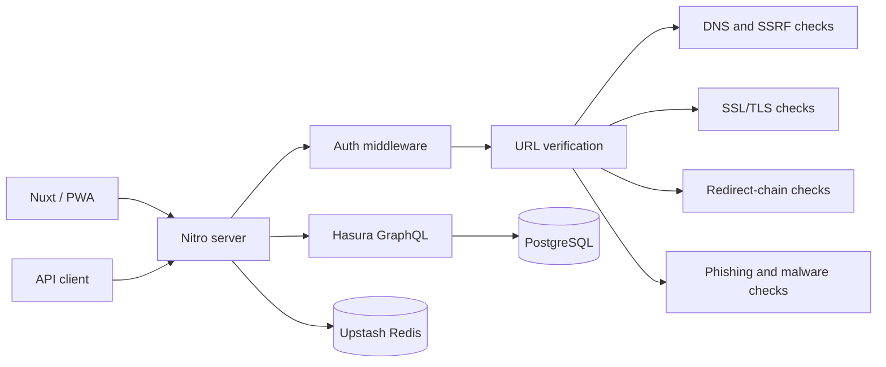

# LinkShort

Secure, type-safe URL shortening with URL verification, authentication, analytics, and a
Progressive Web App (PWA) experience.

[](https://github.com/WomB0ComB0/link-shortener/actions/workflows/ci.yml)
[](LICENSE)

## Features

- Short links with optional custom aliases and expiration dates.
- Anonymous creation protected by a master password, plus authenticated link management.
- Signed session tokens using `JWT_SECRET`.
- Click analytics including user agent, referrer, IP, country, and city.
- 9-stage URL security & OSINT verification covering syntax/SSRF, DNS, SSL/TLS, redirect chains, phishing heuristics, malware, Cloudflare/Quad9 threat DNSBLs, RDAP age/DNSSEC/CAA/DMARC, and HTTP security headers/HTML cloaking.
- Redis-backed rate limiting, ban lists, and verification-result caching.
- Hasura GraphQL over PostgreSQL for persistence.
- API-key creation, masking, and revocation.
- Responsive Nuxt UI with offline/PWA support.

## How it works



The application is a Nuxt SSR/PWA frontend and a Nitro API in one deployable
process. Hasura is the database API; the application does not connect directly to
PostgreSQL at request time. Redis is used for rate-limit state, ban lists, and
short-lived verification caching.

### Link creation flow

1. The request body is decoded with `CreateShortLinkRequest`.
2. The caller is resolved from a session token, an active `sk_` API key, or the
   master-password header.
3. Unless an explicit internal bypass is used, the URL enters the verification
   pipeline.
4. The pipeline validates the URL and checks DNS before opening outbound HTTP/TLS
   connections. This is the SSRF gate.
5. Redirects are inspected manually with a hop limit, loop detection, private-IP
   protection, and HTTPS-to-HTTP downgrade detection.
6. DNS, SSL, phishing, and malware results determine the risk level.
7. The alias/code is checked for collisions, then the link is inserted in Hasura.

Verification failures are fail-closed for critical risks. High-risk links are
blocked for anonymous callers; authenticated callers receive the risk result and
may proceed according to the endpoint policy.

### Redirect flow

`GET /<short-code>` loads the active link, rejects disabled or expired links, records
click metadata asynchronously, and returns a `302` redirect. Click recording is
deliberately non-blocking so an analytics failure does not prevent a valid redirect.

## Stack

| Area | Technology |
| --- | --- |
| Application | Nuxt 4, Vue 3, Nitro |
| Styling | Tailwind CSS 4, Nuxt UI |
| Validation | TypeScript, Effect Schema |
| Persistence | PostgreSQL, Hasura GraphQL |
| Rate limiting/cache | Upstash Redis |
| Testing | Vitest, Playwright |
| Package manager | Bun |

## Quick start

### Prerequisites

- Node.js 22 or newer
- Bun 1.4 or newer
- A Hasura GraphQL endpoint backed by PostgreSQL
- Upstash Redis credentials

### Install and run

```bash
git clone https://github.com/WomB0ComB0/link-shortener.git
cd link-shortener
bun install
cp .env.example .env
# Fill in the required values in .env
bun run dev
```

The development server runs at <http://localhost:3000>.

Apply the SQL migrations in `migrations/` to the PostgreSQL database before using
authenticated features. The Hasura metadata/schema must expose the application tables.

The migrations create these tables:

| Table | Purpose |
| --- | --- |
| `users` | Account identity and profile data |
| `short_links` | Destination URLs, aliases, ownership, and expiry |
| `clicks` | Redirect analytics |
| `api_keys` | Hashed/API-key metadata and lifecycle state |

`short_links.user_id` uses `ON DELETE SET NULL`; click rows cascade when a short
link is deleted, and API keys cascade when their user is deleted.

## Configuration

The complete template is in `.env.example`. The most important variables are:

| Variable | Purpose |
| --- | --- |
| `HASURA_GRAPHQL_ENDPOINT` | Hasura GraphQL URL |
| `HASURA_GRAPHQL_ADMIN_SECRET` | Server-side Hasura admin secret |
| `UPSTASH_REDIS_REST_URL` | Upstash Redis REST URL |
| `UPSTASH_REDIS_REST_TOKEN` | Upstash Redis REST token |
| `MASTER_PASSWORD_HASH` | SHA-256 hash used for anonymous link creation |
| `JWT_SECRET` | Secret used to sign and verify session tokens |
| `GOOGLE_SAFE_BROWSING_API_KEY` | Optional malware scanning integration |
| `URLHAUS_AUTH_KEY` | Optional Abuse.ch URLhaus Auth-Key for URL-level malware lookups |
| `ADMIN_BYPASS_SECRET` | Optional server-side verification bypass secret |

Never commit `.env` or production secrets.

## HTTP API

### Authentication

```text
POST /api/auth/register
POST /api/auth/login
GET  /api/auth/me
```

Registration accepts `email`, `password`, and an optional `displayName`. Login and
registration return a signed session token. Send it on protected requests:

```http
Authorization: Bearer <session-token>
```

### Links

```text
POST /api/links/create
GET  /api/links/me
GET  /api/links/public
GET  /api/links/analytics?shortLinkId=<uuid>
GET  /api/security/verify?url=<url>
GET  /<short-code>
```

Create a link with:

```bash
curl -X POST http://localhost:3000/api/links/create \
  -H 'Content-Type: application/json' \
  -H 'x-master-password: YOUR_MASTER_PASSWORD' \
  -d '{
    "originalUrl": "https://example.com/a-long-path",
    "customAlias": "example",
    "expiresAt": "2027-01-01T00:00:00.000Z"
  }'
```

Authenticated requests may use the session token instead of `x-master-password`.
The redirect route is the short code itself, for example
`http://localhost:3000/example`.

### Authentication matrix

| Route family | Session token | `sk_` API key | Master password |
| --- | :---: | :---: | :---: |
| `/api/links/create` | Yes | Yes | Yes |
| `/api/links/analytics` | Yes | Yes | Yes |
| `/api/keys/*` | Yes | No | Explicitly rejected unless valid fallback behavior is configured |

Session tokens are signed server-side and expire after seven days. API keys are
scoped to the owning account and are not permitted to create or revoke other API
keys.

### API keys

```text
POST /api/keys/create
GET  /api/keys/list
POST /api/keys/revoke
```

These routes require authentication middleware. API keys are only shown in full when
created; subsequent listings mask all but the final eight characters.

## Development

Useful commands:

```bash
bun run dev
bun run build
bun run test -- --run
bun run test:e2e -- --project=chromium
bun audit --production --audit-level=high
```

The server test suite covers API handlers, middleware, authentication, schemas,
link services, URL security checks, DNS/SSL checks, and Redis-backed helpers.
Playwright covers landing-page behavior, authentication, link creation, offline
recovery, success flows, and error flows.

### Continuous integration

Pull requests and pushes to `master` run:

- Frozen Bun dependency installation.
- Vitest unit/server tests.
- A production Nuxt build.
- Chromium Playwright tests.
- Production dependency auditing at high/critical severity.
- CodeQL, dependency review, bundle analysis, and Dependabot automation.

The local Playwright configuration defines Chromium, Firefox, WebKit, mobile, and
branded-browser projects. CI currently installs and runs Chromium only; install the
other browser binaries locally before running those projects.

## Deployment notes

The production artifact is the Nuxt Node server generated by `bun run build`.
Deploy it with the same runtime environment variables used locally and expose the
server's port 3000. Provision PostgreSQL/Hasura and Redis separately, apply every
migration in order, and keep `HASURA_GRAPHQL_ADMIN_SECRET`, `UPSTASH_REDIS_REST_TOKEN`,
`JWT_SECRET`, `MASTER_PASSWORD_HASH`, and `ADMIN_BYPASS_SECRET` private.

Do not enable `ADMIN_BYPASS_SECRET` for ordinary public clients. It is intended for
controlled server-side operations and bypasses URL verification checks.

## Troubleshooting

| Symptom | Check |
| --- | --- |
| `401 Authentication required` | Confirm the `Authorization: Bearer ...` token is present and `JWT_SECRET` matches the issuer environment. |
| `403 Invalid master password` | Recompute `MASTER_PASSWORD_HASH` as a SHA-256 hex digest and ensure the header is `x-master-password`. |
| Hasura errors | Check endpoint/admin secret, database connectivity, table tracking, and migration order. |
| Redis errors | Check both `UPSTASH_REDIS_REST_URL` and `UPSTASH_REDIS_REST_TOKEN`; rate limiting and ban-list operations depend on them. |
| Playwright browser missing | Run `bunx playwright install --with-deps chromium` for the CI-equivalent project, or install the requested browser project. |
| Verification is slow | Inspect DNS, TLS, and redirect targets; the pipeline applies per-check and total timeouts and caches completed results. |

## Project layout

```text
app/                 Nuxt pages, components, composables, and styles
server/api/          Nitro API handlers
server/security/     URL, DNS, SSL, phishing, and malware checks
server/middleware/   Authentication and rate limiting
server/services/     Link-domain services
server/utils/        Auth, validation, and GraphQL helpers
lib/                 Shared fetcher, Redis, ban-list, IP, and GraphQL utilities
migrations/          PostgreSQL schema migrations
src/e2e/             Playwright browser tests
.github/workflows/   CI, security, dependency, build, and E2E workflows
```

## Security

Report vulnerabilities privately through GitHub security advisories rather than
opening a public issue. Do not include credentials, tokens, or private URLs in bug
reports.

## License

Licensed under the Apache License 2.0. See [LICENSE](LICENSE).
